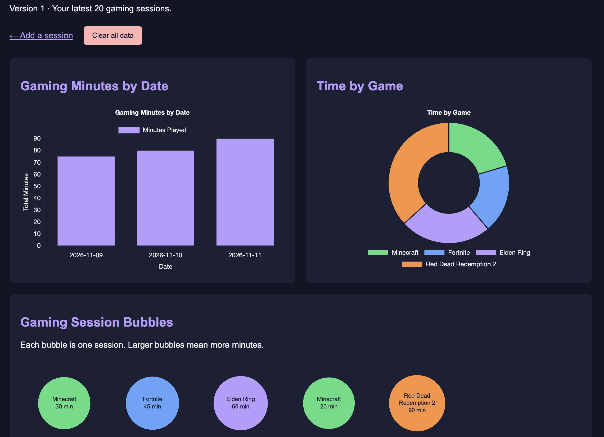
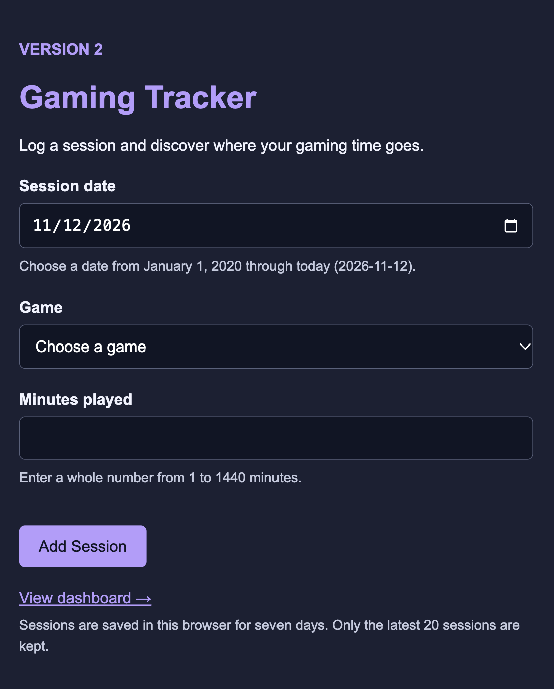
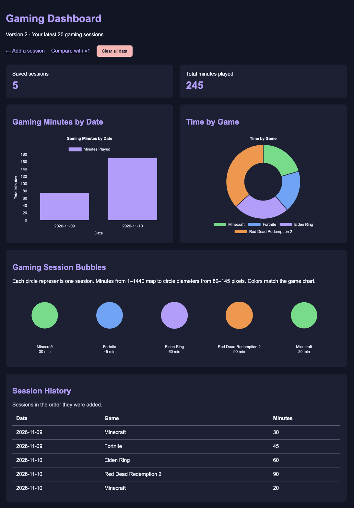
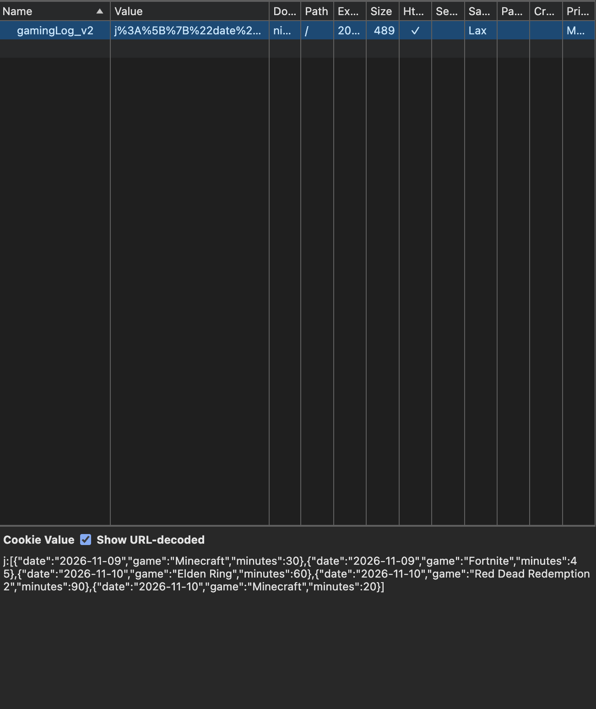

# FF-Express-Fall26
# Cookie Tracker – Gaming Sessions

Video walkthrough:

## What I tracked and why

I created a gaming tracker that records the date, game, and minutes played for each session. I chose gaming because it interests me, and I wanted a way to see how my time is divided between different games.

The app stores the latest 20 sessions in a browser cookie using Express and cookie-parser. The dashboard includes a bar chart of minutes by date, a doughnut chart of minutes by game, and a p5.js bubble sketch.

## Running the app

Run these commands in the project folder:

    npm install
    npm start

Then visit:

- http://localhost:3000/tracker/v1
- http://localhost:3000/tracker/v1/dashboard
- http://localhost:3000/tracker/v2
- http://localhost:3000/tracker/v2/dashboard

In Codespaces, use the forwarded port 3000 address with the same paths.

Each browser has its own saved data. The two versions use separate cookies.

## Version 1 (prompt v1)

[Prompt v1](tracker-docs/prompt-v1.md)



### What worked

- Adding sessions updated both charts and the bubbles.
- Sessions on the same date were combined in the bar chart.
- Minutes for the same game were combined in the doughnut chart.
- Sessions remained after refreshing and reopening the tab.
- Empty required fields triggered the browser's validation message.
- Clear all data emptied the dashboard.

### What needed improvement

- The app accepted 99999 minutes because there was no maximum.
- A date with year 0026 was accepted and appeared before the 2026 dates.
- The form needed clearer instructions about allowed values.

## Version 2 – Final (prompt v2)

[Prompt v2 and v1 test log](tracker-docs/prompt-v2.md)







### Biggest change from v1 to v2, and why it helped

The biggest improvement was input validation. Version 2 only accepts whole number session lengths from 1 to 1440 minutes and real dates from January 1, 2020 through today. These checks happen in both the form and the Express route.

Version 2 also adds session totals, a session history table, clearer form instructions, and bubble labels below the circles. The sketch rearranges when the browser is resized.

### Final testing

| Test | Result |
|------|--------|
| Added five sessions | Dashboard showed 5 sessions and 245 total minutes. |
| Refreshed the dashboard | All five sessions and the total remained. |
| Submitted 99999, 0, and 1.5 minutes | All were blocked. |
| Submitted year 0026 and a future date | Both were blocked. |
| Narrowed the browser window | Charts stacked and bubbles rearranged. |
| Clicked Clear all data | Totals became zero and charts, bubbles, and history emptied. |
| Inspected gamingLog_v2 in DevTools | The cookie contained the five saved sessions. |

### Hand edits I made

After generating v2, I added an AI-assisted customization: a confirmation dialog for Clear all data. I added confirmGamingClearV2() to the dashboard script and connected it to the clear form's onsubmit event. Cancel stops the submission, while OK allows the cookie to be cleared.

## How my code works (in my own words)

### Saving the cookie

The saved sessions are read inside gamingV2ReadEntries():

```javascript
const saved = req.cookies.gamingLog_v2;
```
The POST route then adds and saves the new session:

```javascript
let entries = gamingV2ReadEntries(req);

entries.push({
    date: values.date,
    game: values.game,
    minutes: minutes
});

entries = entries.slice(-20);

res.cookie("gamingLog_v2", entries, {
    maxAge: 7 * 24 * 60 * 60 * 1000,
    httpOnly: true,
    sameSite: "lax",
    path: "/"
});

res.redirect("/tracker/v2/dashboard");
```
The application retrieves the previous sessions from req.cookies.gamingLog_v2. The helper function ensures that it validates those entries successfully and returns an array. When the new session is validated, it is added with push and only the last 20 sessions are keeped by slice(-20). The updated array is saved on the browser using res.cookie. The cookie lasts for seven days, has its httpOnly property set to avoid any JavaScript access, has the sameSite property with the value "lax" to limit the cross-site sending, and has the path property that is set to "/" to be available in the whole application. Finally, the application redirects to the dashboard.

### Getting the data to the dashboard

```javascript
app.get("/tracker/v2/dashboard", (req, res) => {
    const entries = gamingV2ReadEntries(req);
    let totalMinutes = 0;

    for (let i = 0; i < entries.length; i++) {
        totalMinutes += entries[i].minutes;
    }

    res.render("tracker-dashboard-v2", {
        title: "Gaming Dashboard v2",
        entries: entries,
        sessionCount: entries.length,
        totalMinutes: totalMinutes,
        entriesJSON: JSON.stringify(entries).replace(/</g, "\\u003c")
    });
});
```
When the dashboard is activated, it utilizes gamingV2ReadEntries(req) to read and verify the cookie data. The program runs a loop to aggregate the session minutes and derive the total number of minutes. After this, res.render sends the entries, session count, and total minutes data to the Handlebars page, along with a JSON representation of the entries to be used by JavaScript in the dashboard. Less-than symbols are replaced with their escape sequences to include the data in the script without problems.

### Chart 1

```javascript
const dailyTotals = {};

for (let i = 0; i < entries.length; i++) {
    const entry = entries[i];

    if (dailyTotals[entry.date] === undefined) {
        dailyTotals[entry.date] = 0;
    }

    dailyTotals[entry.date] += entry.minutes;
}

const dates = Object.keys(dailyTotals).sort();
const dailyMinutes = [];

for (let i = 0; i < dates.length; i++) {
    dailyMinutes.push(dailyTotals[dates[i]]);
}
```
The first loop organizes the sessions according to their dates and totals up their minutes. It means that when the same day has several sessions, they are all represented by one bar in the chart. After that, the dates are ordered, and there is another loop which creates the same list with the number of minutes for each given date. Then, Chart.js uses the dates along the horizontal axis and the number of minutes as the vertical dimension of the bars.

### p5 sketch

```javascript
const x = (i % columns) * cellWidth + cellWidth / 2;
const rowTop = Math.floor(i / columns) * 220;
const diameter = map(entry.minutes, 1, 1440, 80, 145);
const fittedDiameter = Math.min(diameter, cellWidth - 12);

fill(gameColors[entry.game]);
circle(x, rowTop + 80, fittedDiameter);
```

Every saved session is represented by a circle. The number of minutes of that session determines the diameter, where 1-1440 minutes correspond to 80-145 pixels in diameter. The game attributes the color of each circle, which corresponds to that of the doughnut chart. The row and column of the session depend on the session's position within the array and show the context of the game and the minutes below the circle. Raizing the browser causes the grid to wrap. Thus, it is possible to see that the session adds up to one circle, while removing all data means clearing all circles.

## Something the AI got wrong

The first AI-generated version did not put an upper limit on session minutes or restrict dates to a reasonable range. Testing showed that it accepted 99999 minutes and a date with year 0026. I made the second prompt more specific about validation, and the final version blocked those inputs.